# NETWORKWALKS-BO84-WK4-PENTRATION-TESTING
A practical Web Application Penetration Testing project using Kali Linux, Dirsearch, SQLmap and cybersecurity assessment techniques.

# PENETRATION TESTING – MEDIROZA GENERAL HOSPITAL

## 📌 Project Overview

This project documents a black-box penetration testing assessment conducted against the Mediroza General Hospital website as part of an educational cybersecurity practical.

The assessment focused on identifying security weaknesses in the website, examining its patient portal authentication mechanism, evaluating PDF document protection, and discovering exposed directories and outdated resources.

The project was completed through three major milestones:

## 🎯 Project Objectives

- Understand the fundamentals of black-box penetration testing.
- Identify potential security weaknesses in a web application.
- Examine patient portal authentication mechanisms.
- Assess SQL Injection vulnerabilities.
- Understand PDF password protection and hash extraction.
- Perform directory and file enumeration.
- Identify exposed resources and outdated files.
- Evaluate security risks and potential impacts.
- Provide recommendations to improve website security.

---

## 🛠️ Tools and Technologies Used

| Tool | Purpose |
|---|---|
| Kali Linux | Security testing environment |
| Dirsearch | Directory and file enumeration |
| SQLmap | SQL Injection assessment |
| Web Browser | Website examination and testing |
| Online PDF Hash Extractor | PDF password hash extraction |
| NetworkWalks Password Cracker | PDF password recovery assessment |

---

## 🖥️ Project Environment

- **Operating System:** Kali Linux
- **Assessment Type:** Black-Box Penetration Testing
- **Target Organisation:** Mediroza General Hospital
- **Target Website:** https://medirozahospital.com
- **Assessment Duration:** 5 Days
- **Assessment Date:** 26 November 2026

---

# 📂 MILESTONE 1 – INITIAL ACCESS AND PATIENT PORTAL TESTING

## 1. Introduction

The first milestone focused on examining the target website and assessing the security of its patient portal.

The main objective was to identify authentication weaknesses and determine whether confidential patient information could be accessed without proper authorisation.

## 2. Objectives

- Examine the target website.
- Identify the patient portal login page.
- Assess the authentication mechanism.
- Perform SQL Injection testing within the authorised scope.
- Evaluate possible authentication bypass.
- Retrieve the three laboratory report PDFs required for the practical.
- Document the findings and security risks.

## 3. Tools Used

- Kali Linux
- Web Browser
- SQLmap
- Dirsearch

## 4. Execution Procedure

### Step 1: Target Website Examination

Opened the target website in a browser and examined its available pages and functionalities.

### Step 2: Identify the Patient Portal

Navigated to the patient portal and examined its login form, including the username and password fields.

### Step 3: Authentication Testing

Examined how the application handled user input and assessed the login mechanism for possible authentication weaknesses.

### Step 4: SQL Injection Assessment

Performed controlled SQL Injection testing within the authorised practical scope to investigate whether user input could affect database queries.

### Step 5: Verify Authentication Weakness

The manual login test demonstrated an authentication bypass, allowing access to the patient portal.

### Step 6: Retrieve Laboratory Reports

Following the reported successful portal access, three patient laboratory report PDFs were retrieved for the practical.

### Step 7: SQLmap Testing

SQLmap was also used to examine the target for SQL Injection vulnerabilities.

During automated testing, SQLmap reported possible WAF/IPS protection and returned an HTTP 403 Forbidden response. It did not independently confirm the vulnerability.

## 5. Findings

- An SQL Injection-related authentication weakness was demonstrated through manual testing.
- Access to the patient portal was reportedly achieved.
- Three patient laboratory report PDFs were retrieved.
- SQLmap did not independently confirm the vulnerability.

**Risk Rating: Critical**

## 6. Potential Impact

- Unauthorised access to patient records.
- Exposure of confidential medical information.
- Violation of patient privacy.
- Potential misuse of sensitive information.

## 7. Recommendations

- Implement parameterised SQL queries.
- Use secure authentication mechanisms.
- Validate and sanitise user inputs.
- Apply appropriate database permissions.
- Implement role-based access controls.
- Monitor suspicious login activities.
- Conduct regular security assessments.

----

# 📂 MILESTONE 2 – PDF HASH EXTRACTION AND PASSWORD RECOVERY

## 1. Introduction

The second milestone focused on examining the password protection applied to the three PDF laboratory reports retrieved during M1.

The objective was to extract the PDF password hashes and assess whether the passwords protecting the documents could be recovered.

## 2. Objectives

- Examine the three PDF documents.
- Understand PDF password protection.
- Extract password hashes from the PDF files.
- Perform password recovery in the authorised practical environment.
- Verify whether the PDF contents could be accessed.
- Document the results and security implications.

## 3. Tools Used

- Kali Linux
- Web Browser
- Online PDF Hash Extractor
- NetworkWalks Password Cracker

## 4. Execution Procedure

### Step 1: Collect PDF Documents

Used the three PDF laboratory reports obtained during Milestone 1 in the authorised practical environment.

### Step 2: Examine PDF Protection

Examined the documents to identify their password protection mechanisms.

### Step 3: Extract PDF Hashes

Used the Online PDF Hash Extractor to extract the password hashes associated with the PDF files.

### Step 4: Perform Password Recovery

Submitted the extracted hashes to NetworkWalks Password Cracker for password recovery within the authorised exercise.

### Step 5: Verify Recovery Results

Checked whether the password recovery process was successful and whether the contents of the PDF documents could be accessed.

### Step 6: Collect Evidence

Recorded screenshots of the hash extraction and password recovery results.

## 5. Findings

During the assessment:

- Password hashes were extracted from all three PDF files.
- The extracted hashes were submitted for password recovery.
- Password recovery was successful for all three PDF documents.
- The contents of all three PDF files were accessible.

**Result:** Successful password recovery for all three PDF reports.

**Risk Rating: High**

## 6. Potential Impact

- Confidential patient documents could be exposed.
- Weak PDF passwords could be recovered.
- Sensitive medical information could be accessed.
- Document confidentiality could be compromised.

## 7. Recommendations

- Use strong and unique document passwords.
- Apply appropriate encryption to sensitive PDF documents.
- Avoid relying on PDF passwords as the only security control.
- Restrict access to confidential patient documents.
- Implement secure authentication and authorisation.
- Review document-sharing policies regularly.

---

# 📂 MILESTONE 3 – DIRECTORY ENUMERATION AND INFORMATION DISCOVERY

## 1. Introduction

The third milestone focused on identifying exposed directories, files and resources on the target website using Dirsearch.

The objective was to discover publicly accessible resources and investigate whether outdated files or patches could expose confidential organisational information.

## 2. Objectives

- Perform directory and file enumeration.
- Identify accessible website directories.
- Examine HTTP response codes.
- Identify outdated or unnecessary resources.
- Investigate the discovered old patch.
- Identify reported exposure of staff salary and shareholder information.
- Document security findings and recommendations.

## 3. Tools Used

- Kali Linux
- Dirsearch
- Web Browser

## 4. Execution Procedure

### Step 1: Prepare the Testing Environment

Opened Kali Linux and prepared the authorised testing environment.

### Step 2: Perform Directory Enumeration

Used Dirsearch to examine the target website for accessible directories and files.

### Step 3: Analyse Scan Results

Reviewed the discovered paths and examined their HTTP response codes.

The assessment identified the following response codes:

| HTTP Status | Meaning |
|---|---|
| 200 | Successful response |
| 301 | Redirection |
| 403 | Forbidden access |

### Step 4: Identify Exposed Resources

Reviewed the discovered directories and files to identify potentially outdated or unnecessary resources.

### Step 5: Investigate the Old Patch

An old patch was identified in the Dirsearch results.

Further investigation of the discovered resource provided a lead to staff salary information and shareholder details.

### Step 6: Document Findings

Recorded the discovered resources, potential security implications and recommendations.

## 5. Discovered Directories and Paths

The practical identified the following paths:

| Discovered Path | Observation |
|---|---|
| `/about.html` | About page |
| `/staff/` | Staff directory |
| `/robots.txt` | Robots file |
| `/wp-admin/` | WordPress administration path |
| `/server-status` | Server status path |
| `/controlpanel/` | Control panel path |
| `/webmail/` | Webmail path |
| `/wp-login.php` | WordPress login path |

**Note:** The presence of these paths does not automatically establish that they are vulnerable. Further authorised investigation is necessary.

## 6. Major Findings

### Finding 1: Old Patch Discovery

An old patch was identified during directory enumeration. Further investigation of the discovered resource provided a lead to internal organisational information.

### Finding 2: Staff Salary Information Exposure

Staff salary details were located during the investigation.

### Finding 3: Shareholder Information Exposure

Shareholder information was also located during the investigation.

**Risk Rating: High**

## 7. Potential Impact

- Exposure of confidential employee salary information.
- Unauthorised access to shareholder details.
- Misuse of internal organisational information.
- Privacy and confidentiality risks.
- Potential reputational damage.

## 8. Recommendations

- Remove outdated patches and unnecessary files.
- Restrict access to sensitive website directories.
- Avoid storing confidential information in publicly accessible locations.
- Implement authentication and authorisation controls.
- Regularly review web server configurations.
- Monitor exposed directories and resources.
- Conduct periodic security assessments.

---

# 📊 OVERALL RISK ASSESSMENT

The following table summarises the main findings from all three milestones.

| Security Finding | Risk Level |
|---|---|
| SQL Injection authentication bypass | Critical |
| Exposure of patient laboratory reports | Critical |
| PDF password recovery | High |
| Exposure of staff salaries and shareholder information | High |
| Exposed directories and outdated resources | Medium |
| WAF/IPS detection during SQLmap testing | Informational |

The most serious findings were the authentication bypass and exposure of confidential patient information.

---

# 🔐 GENERAL SECURITY RECOMMENDATIONS

Based on the three milestones, the following security improvements are recommended:

1. **Secure Authentication:** Implement strong authentication and secure login mechanisms.
2. **SQL Injection Prevention:** Use parameterised queries and validate user input.
3. **Access Control:** Apply appropriate user roles and permissions.
4. **PDF Security:** Use strong encryption and secure document-sharing practices.
5. **File Management:** Remove outdated patches, backups and unnecessary resources.
6. **Directory Protection:** Restrict access to confidential directories.
7. **Regular Auditing:** Conduct periodic vulnerability assessments.
8. **Monitoring:** Monitor suspicious activities and unauthorised access attempts.

---

# 📸 EVIDENCE COLLECTION

Evidence collected during the practical should be organised into separate folders for each milestone.

# 📋 PROJECT OUTCOMES

After completing all three milestones, the practical demonstrated the following:

| Milestone | Outcome |
|---|---|
| M1 | Patient portal authentication weakness demonstrated |
| M1 | Three patient laboratory reports retrieved |
| M2 | Hashes extracted from three PDF reports |
| M2 | Password recovery successful for all three reports |
| M3 | Website directories and resources identified |
| M3 | Old patch discovered |
| M3 | Staff salary and shareholder information located |

---

# 📸 PROJECT SCREENSHOTS

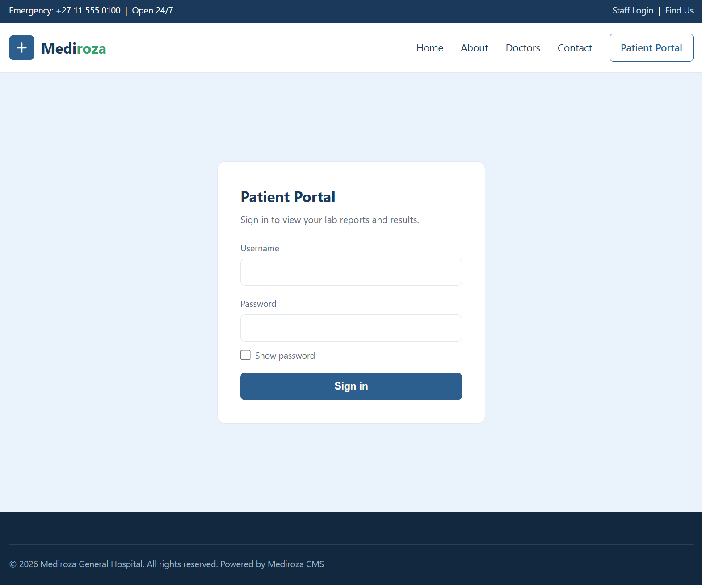
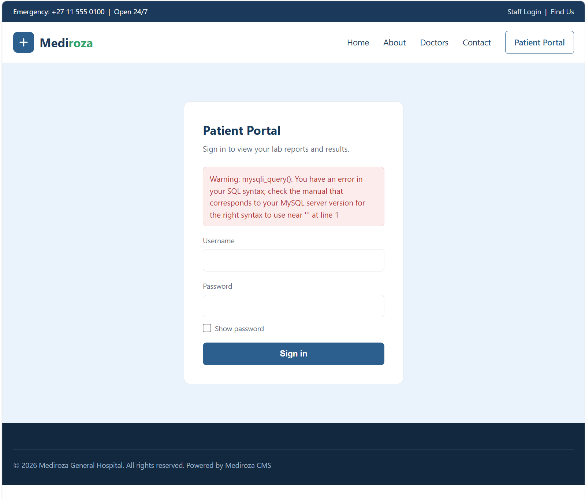
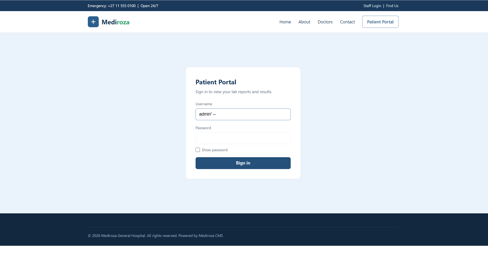
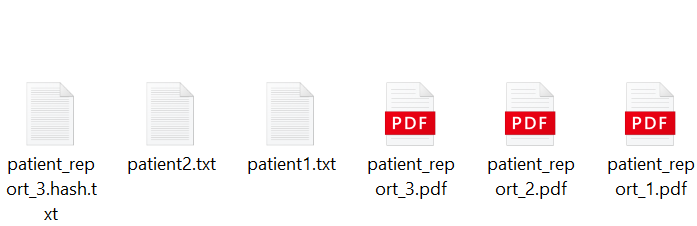
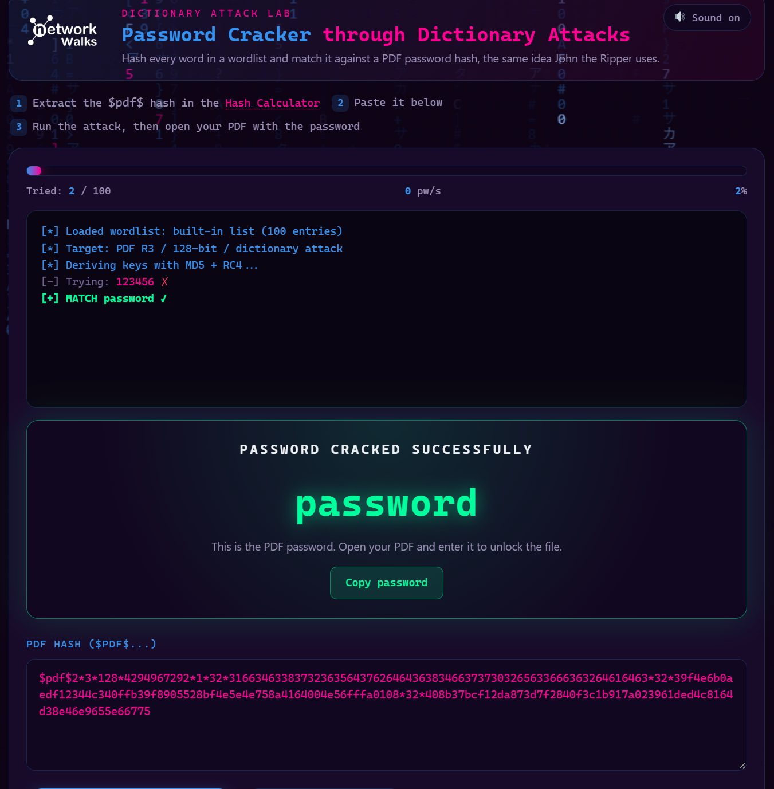
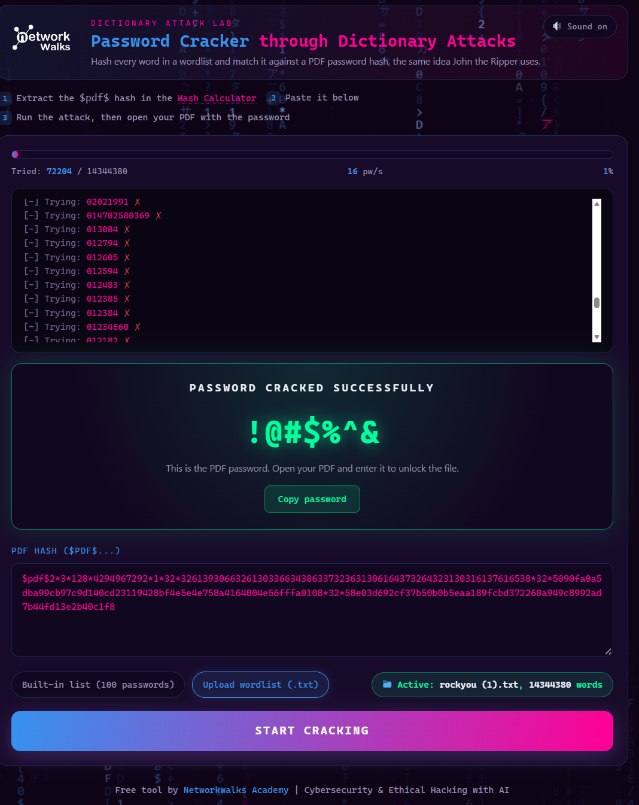
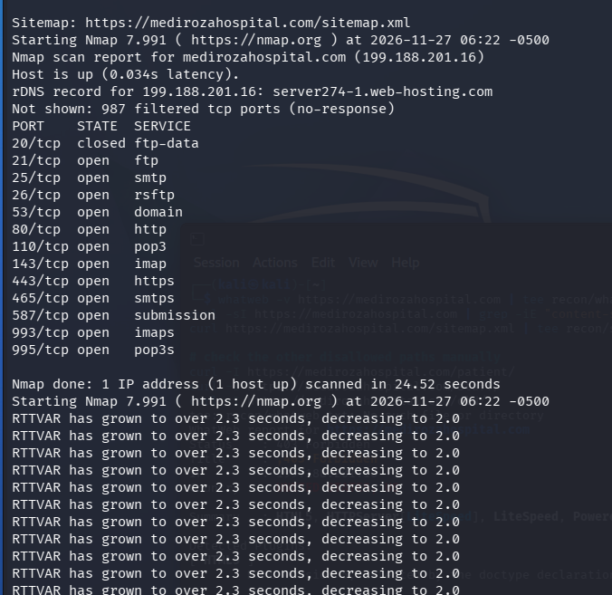
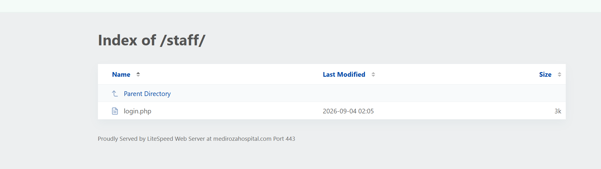
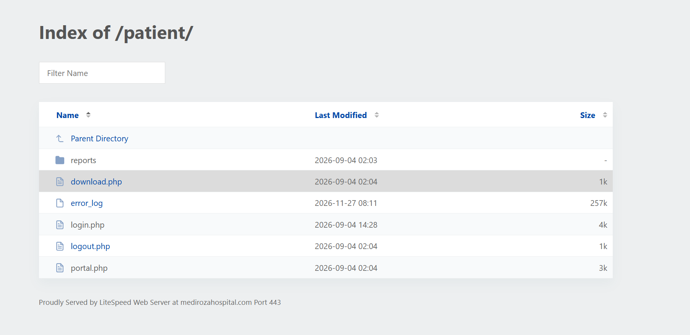
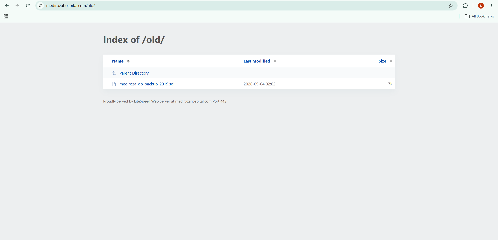
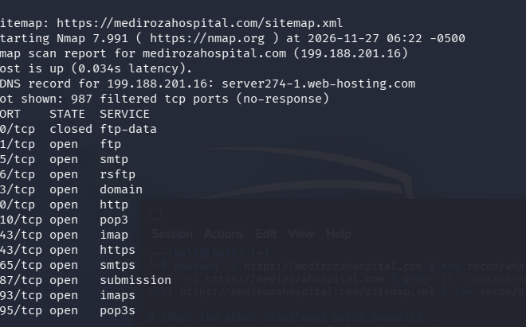
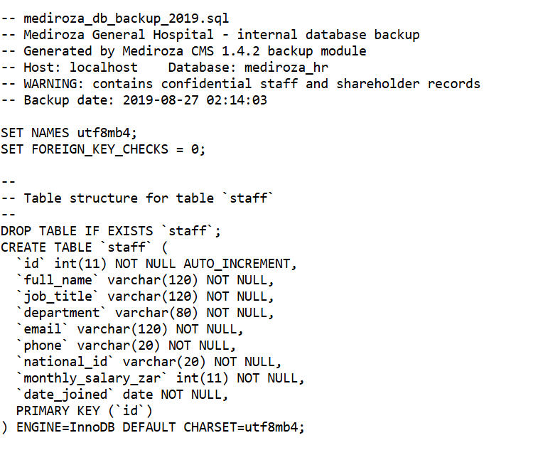
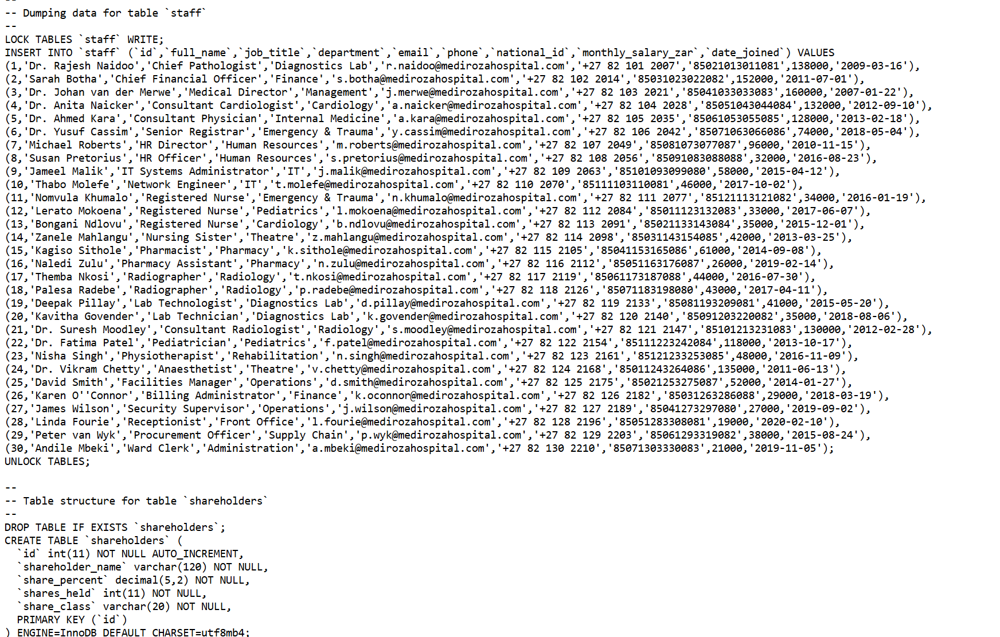
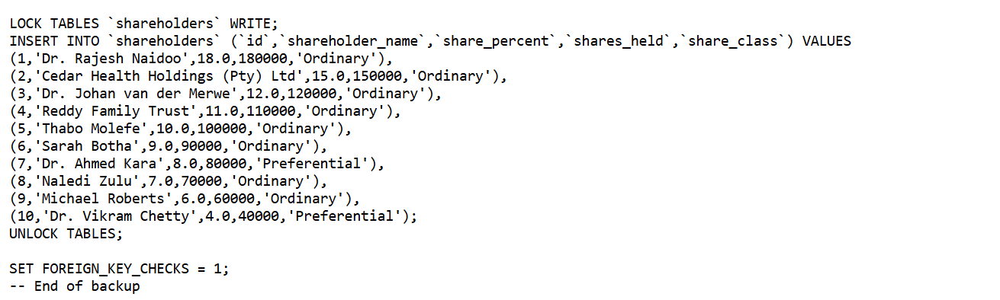

